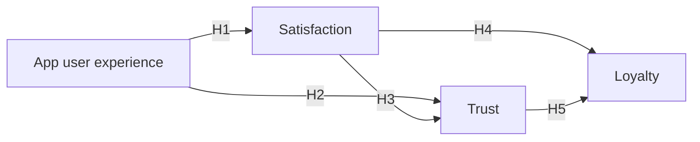
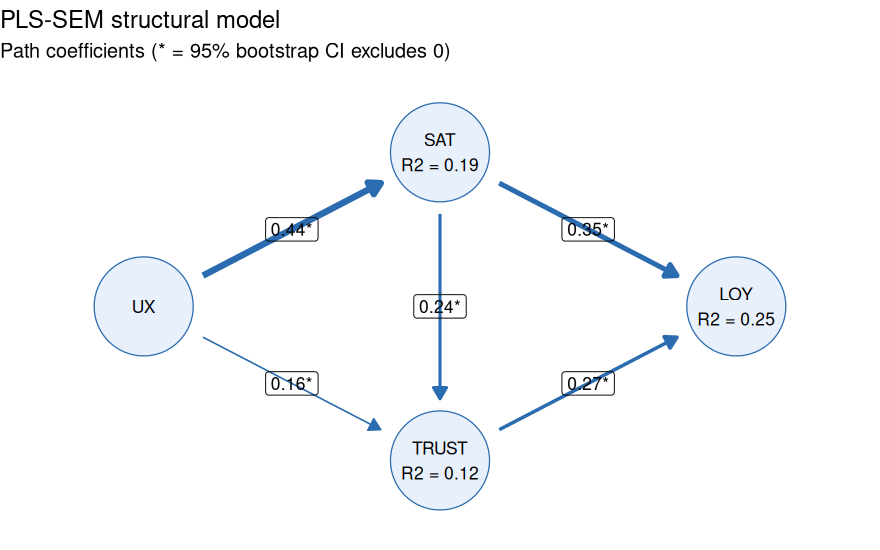
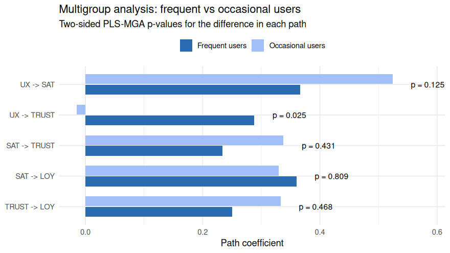

# PLS-SEM: app user experience, satisfaction, trust and loyalty (R, SEMinR)


[](https://github.com/alex-sukhoi/pls-sem-app-experience-loyalty/actions/workflows/reproduce.yml)

A full partial least squares structural equation modelling (PLS-SEM) study, following the reporting
standards of Hair et al. (2021). The question: **how does the user experience of a service
provider's mobile app turn into customer loyalty**, through satisfaction and trust? And does this
work differently for frequent and occasional users?

> **Data:** synthetic (n = 220, 13 items, 7-point Likert), generated in `R/01_simulate_data.R`. PLS-SEM
> suits this design: a small sample, prediction-oriented goals and a mediation chain (Hair et al., 2019).

## Research model and hypotheses



H6: satisfaction and trust mediate the effect of user experience on loyalty.
H7: usage frequency moderates the paths (multigroup analysis).

## Results

### Common-method bias
Harman's single factor explains 32.5% of the variance (< 50%), and every full-collinearity VIF is
1.23–1.49 (< 3.3; Kock, 2015). Common-method bias is not a concern.

### Measurement model

| Construct | Loadings | Cronbach's α | ρA | ρC (CR) | AVE |
|---|---|---|---|---|---|
| User experience | .81–.88 | .87 | .88 | .91 | .72 |
| Satisfaction | .90–.93 | .90 | .90 | .94 | .83 |
| Trust | .83–.91 | .84 | .86 | .90 | .76 |
| Loyalty | .85–.92 | .85 | .87 | .91 | .77 |

- Every loading is > .70, and every reliability index is > .70 and below .95 (no redundant items).
- Convergent validity: AVE .72–.83 (> .50).
- Discriminant validity: Fornell–Larcker met (√AVE .85–.91 > r ≤ .44). HTMT ≤ .50, and every
  bootstrap 95% CI is below .85.

### Structural model (1,000 bootstrap resamples)

<p align="center"></p>

| Hypothesis | Path | β | 95% CI | f² | Supported |
|---|---|---|---|---|---|
| H1 | UX → Satisfaction | .44 | [.32, .54] | .24 (medium) | ✅ |
| H2 | UX → Trust | .16 | [.04, .28] | .02 (small) | ✅ |
| H3 | Satisfaction → Trust | .24 | [.11, .36] | .05 (small) | ✅ |
| H4 | Satisfaction → Loyalty | .35 | [.23, .48] | .15 (medium) | ✅ |
| H5 | Trust → Loyalty | .27 | [.14, .39] | .08 (small) | ✅ |

- R²: satisfaction .19, trust .12, loyalty .26. Inner VIFs < 1.3, so no collinearity.
- **PLSpredict** (10 folds × 10 repetitions): PLS beats the linear-model benchmark on RMSE for 7 of
  9 indicators, which shows medium predictive power (Shmueli et al., 2019).

### Mediation (H6)

| Indirect effect | Estimate | 95% CI |
|---|---|---|
| UX → Satisfaction → Trust | .106 | [.045, .170] |
| Satisfaction → Trust → Loyalty | .064 | [.026, .110] |
| UX → Satisfaction → Trust → Loyalty | .028 | [.011, .049] |
| UX → Trust → Loyalty | .042 | [.010, .085] |

All indirect effects are significant, so H6 is supported: user experience builds loyalty through
satisfaction and trust.

### Multigroup analysis by usage frequency (H7)

<p align="center"></p>

The UX → Trust path is strong for frequent users (β = .29) and absent for occasional users
(β = −.02; difference p = .025). Other paths do not differ. **For frequent users, a good app
experience also builds trust directly.** That is a practical argument for growing active usage.

## Repository structure

```
R/01_simulate_data.R   synthetic survey with a built-in group difference
R/02_pls_sem.R         CMB, measurement model, structural model, PLSpredict, mediation, PLS-MGA
results/               one CSV per table (loadings, reliability, HTMT + CIs, paths, f2, VIF, ...)
figures/               structural model, multigroup comparison
```

## How to run

```r
install.packages(c("seminr", "psych", "ggplot2"))
source("run_all.R")
```

## References

- Hair, J. F., Hult, G. T. M., Ringle, C. M., Sarstedt, M., Danks, N. P., & Ray, S. (2021). *Partial least squares structural equation modeling (PLS-SEM) using R*. Springer.
- Hair, J. F., Risher, J. J., Sarstedt, M., & Ringle, C. M. (2019). When to use and how to report the results of PLS-SEM. *European Business Review, 31*(1), 2–24.
- Henseler, J., Ringle, C. M., & Sarstedt, M. (2015). A new criterion for assessing discriminant validity. *Journal of the Academy of Marketing Science, 43*(1), 115–135.
- Kock, N. (2015). Common method bias in PLS-SEM: A full collinearity assessment approach. *International Journal of e-Collaboration, 11*(4), 1–10.
- Shmueli, G., Sarstedt, M., Hair, J. F., et al. (2019). Predictive model assessment in PLS-SEM: guidelines for using PLSpredict. *European Journal of Marketing, 53*(11), 2322–2347.

---
**Author:** [Oleksii Sukhoi](https://github.com/alex-sukhoi), statistician and data analyst · [LinkedIn](https://www.linkedin.com/in/oleksii-sukhoi-4b60161a7)
